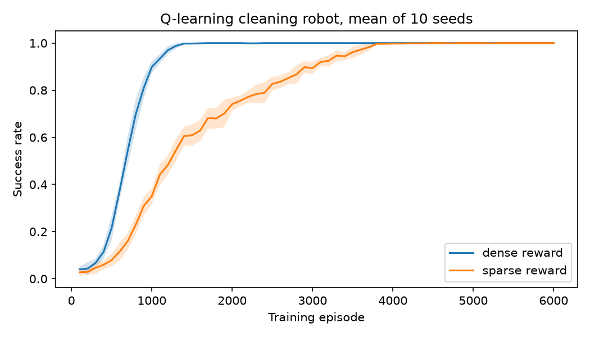

# Cleaning Robot: Q-learning in a grid world

A robot learns to clean a room by trial and error. This project tests whether
a dense reward helps a Q-learning agent learn faster than a sparse reward.

## Setup
- **Environment:** 8×8 grid with 8 obstacles and 6 dirty cells. The episode
  ends when every cell is clean or after 200 steps.
- **State:** robot position and which cells are still dirty.
- **Actions:** up, down, left, right.
- **Agent:** tabular Q-learning, alpha 0.1, gamma 0.99, epsilon decaying
  linearly from 1.0 to 0.05.
- **Rewards:** -0.1 per step and +10 for a clean room. The dense scheme adds
  +1 for each cell cleaned.

## Results
Mean of 10 random seeds, 6,000 training episodes each.

| Reward | Episodes to 90% success | Steps in learned route |
|--------|-------------------------|------------------------|
| Dense  | 1,060                   | 35.0                   |
| Sparse | 2,890                   | 30.2                   |

Both schemes learned a policy that cleans the whole room in 10 out of 10
seeds. A random policy cleans the room in 2% of episodes. The shortest
possible route is 29 steps.



## What I found
- **The hypothesis holds.** The dense reward reached 90% success about 2.7
  times faster than the sparse reward (1,060 episodes against 2,890).
- **There is a trade-off.** The dense agent settled on a 35-step route in
  every seed, 6 steps longer than the shortest possible. The sparse agent
  learned more slowly but found routes of 29 to 31 steps.

## Limitations and next steps
- The dense agent's longer route is not yet explained. The shortest route is
  29 steps under both reward schemes, so the dense reward does not make the
  longer route correct.
- The agent learns one fixed room. It cannot sense obstacles, so a new layout
  needs retraining.

## Run it
```bash
pip install -r requirements.txt
python run_experiment.py
```